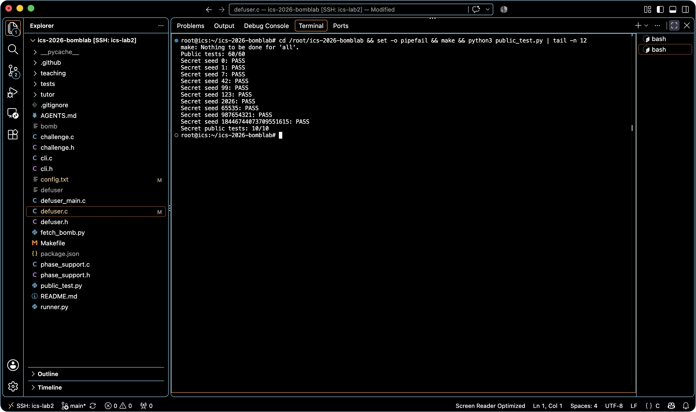
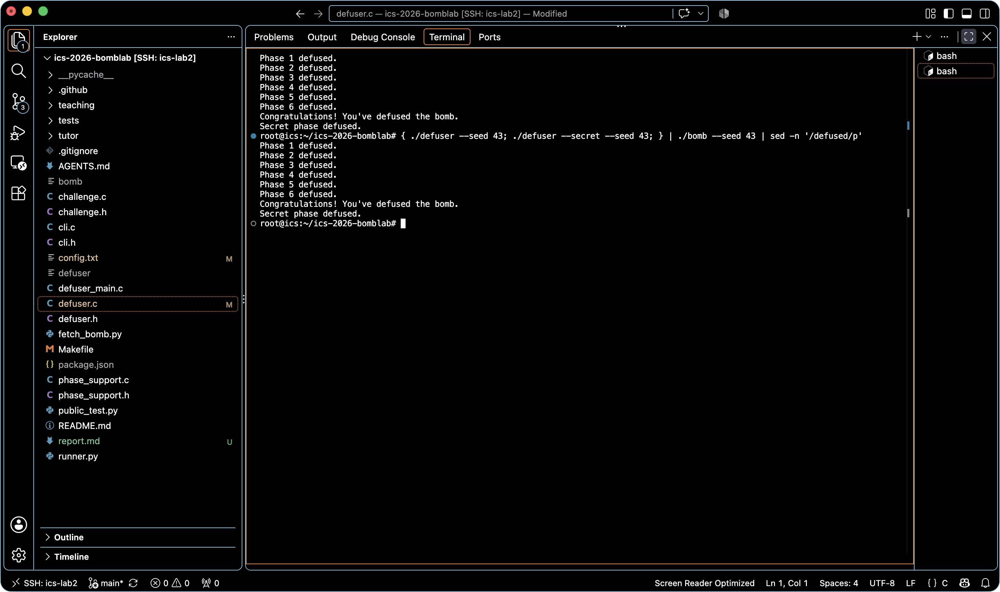

# Lab2：BombLab 实验报告

| 项目 | 内容 |
| --- | --- |
| 姓名 | 李奕晨 |
| 个人仓库 | https://github.com/YichenGPT/ics-2026-bomblab |

## 一、实验对象与分析方法

使用学号领取个人炸弹，下载脚本校验附件归属及 SHA-256。服务器上 `bomb` 的 SHA-256 为：

```text
d4b9c74f2d2ef9190073e03a72c93fd32af6b3bda5402a8a7f7e64b5e69031d8
```

分析时使用 `nm -n bomb` 定位符号，`objdump -d --no-show-raw-insn` 阅读入口与辅助函数，使用 GDB 的 `x` 查看跳转表、链表和函数指针表。动态核对时设断点查看寄存器和输入，未使用 GDB 修改程序变量、寄存器或内存。

正式关卡入口的 `rdi` 指向输入，`rsi` 为 challenge。调用辅助函数时重新追踪实参；不能假设同一个寄存器在所有调用中始终含义相同。以下 `lo(z)` 表示取低 32 位，`hi(z)` 表示取高 32 位；公式中的 32 位加减乘、左移均保留低 32 位，右移采用无符号逻辑右移。实现使用 `uint32_t`，避免依赖有符号整数溢出。

## 二、第 1 关：参数传递与调用链

`phase_01` 在 `0x40209d` 将期望字段数设为 1，在 `0x4020db` 调用 `p1_compute`，随后 `cmp %eax,-0x14(%rbp)` 比较返回值与口令。

`p1_compute` 分别保存 challenge 的低 32 位、高 32 位和右移 16 位后的低 32 位，然后依次调用三个辅助函数。关键指令为：

```asm
p1_step0:
    lea (%rdi,%rdi,4),%eax
    add $0xe973,%esi
    xor %esi,%eax
p1_step1:
    lea (%rdi,%rdi,2),%eax
    add %esi,%eax
    xor $0x618c,%eax
p1_step2:
    sub %esi,%edi
    lea 0xbf4c(%rdi,%rdi,2),%eax
```

令 `L=lo(challenge)`、`H=hi(challenge)`、`M=lo(challenge>>16)`，恢复为：

```text
A = (5*L) XOR (H + 0xe973)
B = (3*H + M) XOR 0x618c
answer = (3*(B-L) + 0xbf4c) XOR A
```

使用非公开 seed 43 时，challenge 为 `0x9cde98852e60034b`。GDB 在 `0x4020e0` 比较点读到 `eax=0xb97de91b`；输入栈位置 `rbp-0x14` 是无符号十进制 `3112036635`，二者相同，继续执行得到 `Phase 1 defused.`。

## 三、第 2 关：数组与循环递推

`phase_02` 要求六个整数。首项由下列指令生成：

```asm
shr $0x2,%rax
add %eax,%eax
movzbl %al,%eax
add $0x1e,%eax
```

所以 `a[0] = (2*lo(challenge>>2) & 255) + 30`。`movzbl %al,%eax` 表示只保留低 8 位，不能误认为保留整个 32 位结果。

循环从 `edx=1`、`ecx=25` 开始，每轮移位量加 2，直到下标达到 6：

```asm
shr %cl,%rax
and $0xf,%eax
xor %edx,%eax
lea (%rax,%rsi,2),%eax
```

恢复出的递推式为：

```text
for i = 1..5:
    part = (challenge >> (25 + 2*(i-1))) & 15
    a[i] = 2*a[i-1] + (part XOR i)
```

seed 43 的输出为 `80 163 328 663 1327 2654`，已经由该 seed 的原始炸弹验证。

## 四、第 3 关：switch 与跳转表

`phase_03` 检查两个整数，第一个必须等于 `challenge & 7`。第二个由 `p3_dispatch` 计算。传入分派函数的另一个参数为：

```text
x = lo(challenge>>3) XOR hi(challenge)
```

`0x40225d` 的 `jmp *0x405820(,%rax,8)` 使用 8 字节跳转表。GDB 读取实际表项并追踪跳转后，得到以下对应关系；索引顺序不能直接按 `p3_case_N` 的后缀猜测。

| 输入索引 | 实际 case | 第二个整数 |
| ---: | ---: | --- |
| 0 | 4 | `5*x + 0x4f411` |
| 1 | 6 | `3*x + 0x5507` |
| 2 | 1 | `(x XOR 0x5525) + (x>>1)` |
| 3 | 2 | `3*x + 0x6263` |
| 4 | 0 | `(x<<2) XOR 0x1e49` |
| 5 | 5 | `(x<<1) XOR 0x1f02` |
| 6 | 7 | `(x XOR 0x787d) + (x>>2)` |
| 7 | 3 | `5*x + 0x23023` |

seed 43 的两个整数是 `7 1432594526`。额外测试覆盖全部 8 种分支。

## 五、第 4 关：递归调用与回溯

`phase_04` 的实参恢复为：目标 `target=challenge&127`，区间 `[0,127]`，以及 `salt=lo(challenge>>7) XOR hi(challenge)`。

`p4_walk` 用 `sub; shr $1; add` 求中点 `mid=low+((high-low)>>1)`，用无符号分支 `jb` 区分目标位于左区间还是右区间。基例 `0x402390` 的 `lea 0x22(%rdi),%eax; xor %ecx,%eax` 给出 `(mid+34) XOR salt`。

递归回溯时，两条路径均将子调用结果乘 3，再与 `mid+salt` 异或；左分支额外异或 2，右分支额外异或 5：

```text
F(t,lo,hi,s):
    m = lo + ((hi-lo)>>1)
    if t == m: return (m+34) XOR s
    if t < m: return (3*F(t,lo,m-1,s)) XOR (m+s) XOR 2
    return (3*F(t,m+1,hi,s)) XOR (m+s) XOR 5
```

`salt` 在递归中保持不变。目标始终在当前区间内，递归会终止；`target=0` 和 `127` 也包含在额外测试中。seed 43 的结果为 `3901035294`。

## 六、第 5 关：结构体布局与链表

`p5_traverse` 从 `p5_heads[challenge&7]` 开始遍历。节点字段读取对应：偏移 0 为 32 位 value，偏移 4 为 32 位 id，偏移 8 为 64 位 next 指针，因此每个节点 16 字节。

GDB 读取 `p5_nodes` 后，以基地址 `0x405ba0`、每 16 字节编号，将指针转换为节点下标：

| 节点下标 | value | id | next 下标 |
| ---: | --- | --- | ---: |
| 0 | `0x38c2` | `0x85c` | NULL |
| 1 | `0x9358` | `0x548` | 10 |
| 2 | `0x2eca` | `0x92b` | 5 |
| 3 | `0x3e11` | `0xa60` | 1 |
| 4 | `0x6132` | `0x30f` | 0 |
| 5 | `0x03b0` | `0x274` | 4 |
| 6 | `0x7779` | `0x10e` | 7 |
| 7 | `0x8757` | `0xb4f` | 9 |
| 8 | `0x56d8` | `0x071` | 2 |
| 9 | `0x612d` | `0x737` | 8 |
| 10 | `0xb218` | `0x656` | 6 |
| 11 | `0x9b43` | `0x461` | 3 |

八个入口下标按顺序为 `[11,3,1,10,6,7,9,8]`。实现不保留二进制绝对地址，而使用这些固定节点数据和下标链接。

关键汇编 `add (%rdx),%eax; lea (%rax,%rax,4),%eax; xor %esi,%eax` 表明每访问一个节点后更新：

```text
acc = lo(challenge>>6) XOR hi(challenge) XOR 0x862
visits = ((challenge>>3)&3) + 1
repeat visits times:
    acc = (5*(acc + node.value)) XOR node.id
    last_id = node.id
    node = node.next
```

循环之前已经访问了一次头节点，因此实际次数是 1–4，而不是 0–3。两个输出分别是最终 acc 和最后节点 id。seed 43 输出 `329526214 628`；额外测试覆盖全部 32 种入口和次数组合。

## 七、第 6 关与 Honor

### 第 6 关：函数指针与两次分派

`p6_dispatch` 的两次间接调用分别使用 `challenge&7` 和 `(challenge>>3)&7`。实际函数指针表为 `[op1,op4,op2,op0,op3,op5,op2,op0]`，包含重复项。

| 表索引 | 运算 T(index,x) |
| ---: | --- |
| 0 | `(x+0x7ecf) XOR (x>>3)` |
| 1 | `(x XOR (x>>7)) + 0xdef2` |
| 2、6 | `((x<<5)+0x2259) XOR (5*x)` |
| 3、7 | 将 x 的 32 位编码循环右移 3 位 |
| 4 | `(x XOR 0x2980) + (x<<5)` |
| 5 | 将 x 循环左移 3 位，再异或 `0x2da9` |

`ror`、`rol` 操作数为 `eax`，需要在 32 位范围循环移位。令 `x=lo(challenge>>6) XOR hi(challenge)`、`i=challenge&7`、`j=(challenge>>3)&7`，结果为：

```text
answer = T(j, T(i,x) XOR 0x8d96) + 0x480a
```

seed 43 输出 `602142486`。额外测试覆盖全部 64 种两次分派组合。

### Honor：对象内覆盖与三数校验

Honor 由前六关成功后的第七行触发。入口 `secret_gate` 保存 challenge 和 context，长度检查要求输入长度位于 36–163。`secret_copy` 逐字节复制直至 NUL；输入对象从 `rbp-0xd0` 开始，门字段位于 `rbp-0xb0`，相差 32 字节。

```asm
call secret_copy
cmpl $0x4e45504f,-0xb0(%rbp)
jne  <失败路径>
lea -0xac(%rbp),%rdi
call secret_phase
```

小端下 `0x4e45504f` 对应 ASCII `OPEN`。所以输出由 32 个 `A`、`OPEN` 和三个十进制整数构成，数值部分从偏移 36 开始。本输入仅覆盖题目对象中的门字段和文本字段，不覆盖返回地址，不使用 shellcode，也不修改调试器中的程序状态。

`secret_phase` 检查三个整数。令 `a=lo(challenge) XOR hi(challenge)`、`b=lo(context) XOR hi(context)`，恢复为：

```text
mode = context & 3
mixed = (rol32(a XOR b,1) + 0x9351) XOR 0xd220
answer = mixed XOR ((mode*0x9351) XOR lo(context>>16))
check = answer XOR (b + mode + 0xd220 + (a>>1))
```

第七行写作 `A×32 + OPEN + mode + 空格 + answer + 空格 + check`。`context` 由未修改的官方驱动根据前六行口令生成；实现直接使用接口传入的 context。seed 43 的数值部分为 `2 754071293 3942773692`，该 seed 的完整七行运行输出 `Secret phase defused.`。

## 八、实际验证记录

重新编译后执行原始公开测试：

```bash
make
python3 public_test.py
```

结果为正式六关 `Public tests: 60/60`，Honor `Secret public tests: 10/10`。截图使用 `tail -n 12` 显示测试输出的末尾摘要；终端开启 `pipefail`。



公开 seed 为 `0,1,7,42,99,123,2026,65535,987654321,18446744073709551615`。另外选用不在公开列表中的 **43**，执行：

```bash
{ ./defuser --seed 43; ./defuser --secret --seed 43; } | ./bomb --seed 43
```



## 九、参考及辅助来源：

1. [课程 Lab2 文档](https://ics-26fall-fdu.github.io/labs/lab2-bomb-lab/)：任务接口、机器环境、调试约束、报告和提交要求。
2. 本人由 [BombLab 模板](https://github.com/ICS-26Fall-FDU/BombLab) 创建的仓库中的 `README.md`、`defuser.h`、官方驱动及 `tutor/phase0_solution.c`：输出协议、接口、seed 和 context 的使用及教学范例。
3. 本人领取的 `bomb`：以上公式、节点数据、分派顺序和 Honor 校验常量均来自该二进制的实际汇编与只读数据。
4. Codex 辅助编程。

